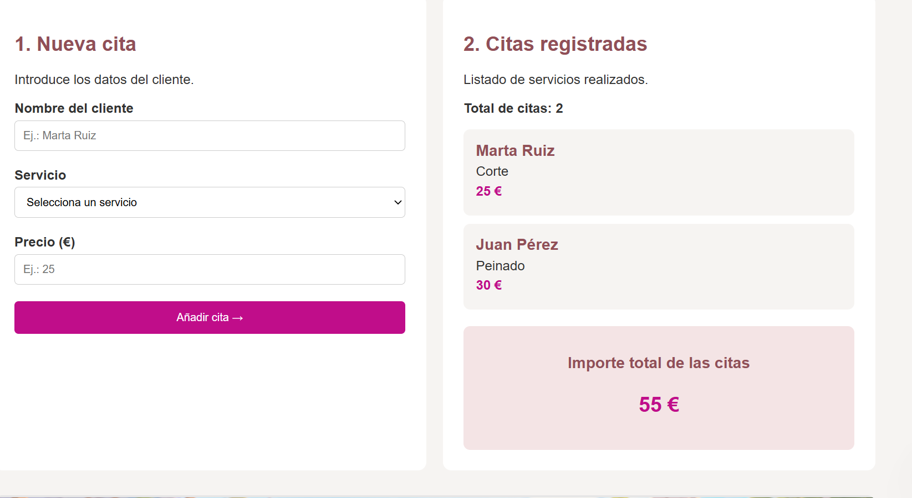

# ✂️ Gestor de citas · Mi peluquería

Aplicación web para gestionar de forma sencilla las citas y los servicios de una peluquería.

Permite consultar las citas registradas, añadir nuevos clientes y calcular automáticamente el importe total de los servicios.

Desarrollada con **HTML, CSS y JavaScript**, sin utilizar librerías ni frameworks externos.

## Vista de la aplicación


## Funcionalidades

- **Listado de citas:** muestra el nombre del cliente, el servicio solicitado y su precio.
- **Registro de nuevas citas:** permite introducir clientes y servicios mediante un formulario.
- **Validación de datos:** utiliza las validaciones de HTML5 para comprobar los campos obligatorios y evitar precios negativos.
- **Contador de citas:** muestra automáticamente el número de citas registradas.
- **Cálculo de importes:** suma los precios de todas las citas y actualiza el total al registrar nuevos servicios.
- **Sección informativa:** incluye un servicio destacado de la semana y consejos de peluquería.

## Panel de citas

Las citas se gestionan mediante un array de objetos de JavaScript. Cada cita contiene tres propiedades: cliente, servicio y precio.

El listado y el importe total se actualizan dinámicamente sin necesidad de recargar la página.



## Tecnologías utilizadas

- **HTML5:** estructura, formularios y validación de datos.
- **CSS3:** diseño visual y adaptación a diferentes tamaños de pantalla.
- **JavaScript:** gestión de citas, manipulación del DOM, eventos y cálculos.

## Estructura del proyecto

```text
citas/
├── index.html
├── styles.css
├── app.js
├── README.md
└── images/
    ├── peluqueriapp.png
    ├── appfuncion.png
    ├── imagenPeluqueria.png
    └── gracias.png
```

## Cómo ejecutar la aplicación

1. Descarga el proyecto o clona el repositorio.
2. Abre la carpeta del proyecto.
3. Abre `index.html` en tu navegador.

No necesita instalación de dependencias ni servidor para su funcionamiento básico.

## Almacenamiento de datos

En la versión básica, las citas se almacenan en un array de JavaScript mientras la página permanece abierta.

Al recargar la página, se recuperan las citas iniciales.

La aplicación puede ampliarse con `localStorage` para conservar los datos entre sesiones.

## Posibles mejoras

- Guardar las citas mediante `localStorage`.
- Añadir fechas y horarios a las reservas.
- Permitir modificar o cancelar citas.
- Filtrar citas por cliente o servicio.

---

**Proyecto desarrollado con HTML, CSS y JavaScript.**"# ActividadFinalCitas" 
